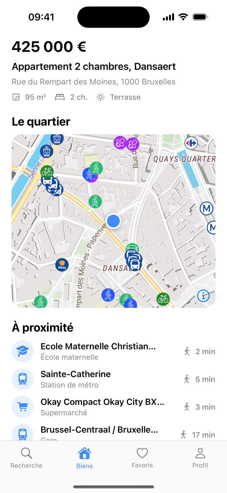

# Yatmo SDK for iOS

[](https://github.com/yatmo/yatmo-sdk-ios/actions/workflows/ci.yml)
[](https://swift.org/package-manager/)

[](LICENSE)

Neighbourhood intelligence for real-estate apps: the [Yatmo](https://yatmo.com) map with the points of interest, travel times and neighbourhood summaries your listing pages need, native on iOS. Built on [MapLibre Native](https://maplibre.org/), no Google Maps or Apple key required.

<p align="center">
  
</p>

## Requirements

- iOS 15+, Xcode 15+, Swift 5.9
- A Yatmo licence: the **frontend key** and your app's **bundle identifier** registered as an [app id](https://documentation.yatmo.com/mobile/app-ids)

## Installation

Xcode: *File > Add Package Dependencies*, paste `https://github.com/yatmo/yatmo-sdk-ios`, add the `YatmoSDK` product. Or in `Package.swift`:

```swift
dependencies: [
    .package(url: "https://github.com/yatmo/yatmo-sdk-ios", from: "1.0.0")
]
```

## Quick start

```swift
import YatmoSDK

let yatmo = Yatmo(configuration: YatmoConfiguration(licenseKey: "YOUR_FRONTEND_KEY", country: .BE, language: .FR))

// UIKit
let map = YatmoMapView(yatmo: yatmo, style: .liberty)
map.showProperty(latitude: 50.8520525, longitude: 4.3442926, zoom: 15)
map.showIsochrones(mode: .walking)                       // 5 / 10 / 20 minute areas, camera fitted like the web plugin
map.onPoiSelected = { poi in print(poi.name, poi.type) }

// SwiftUI
YatmoMap(yatmo: yatmo, latitude: 50.8520525, longitude: 4.3442926, zoom: 15) { poi in print(poi.name) }

// Data
let summary = try await yatmo.client.summary(latitude: 50.8520525, longitude: 4.3442926)
let enrichment = try await yatmo.client.enrichment(latitude: 50.8520525, longitude: 4.3442926)
```

The app id is read from `Bundle.main.bundleIdentifier` and sent with every request. Register it on your licence, otherwise the API answers 403.

## What is inside

| Type | Role |
|---|---|
| `Yatmo`, `YatmoConfiguration` | Licence key, country, language, app id |
| `YatmoClient` | Async client: `summary`, `summaryText`, `scores`, `enrichment`, `points`, `isochrones`, `geocode`, `simplifiedCategories` |
| `YatmoMapView` (UIKit), `YatmoMap` (SwiftUI) | Yatmo map styles on MapLibre, property pin, POI markers following the camera, isochrones, tap callback |
| `YatmoWebView` | `WKWebView` preloaded with the Yatmo iframe plugin (map + summary panel) |

Full guide: https://documentation.yatmo.com/mobile/ios

## Example app

`Example/` is a small SwiftUI app (XcodeGen spec) that shows the map and exercises every client call. Put your key in `Example/Sources/LicenseKey.local.swift` (ignored by git):

```swift
let yatmoTestLicenseKey = "YOUR_FRONTEND_KEY"
```

then `cd Example && xcodegen generate && open YatmoExample.xcodeproj`. Launch arguments: `-demo` shows the listing screen of the screenshot, `-webview` shows the iframe plugin.

## Licence

The SDK is released under the [MIT licence](LICENSE). Using the Yatmo API requires a licence key: https://yatmo.com
